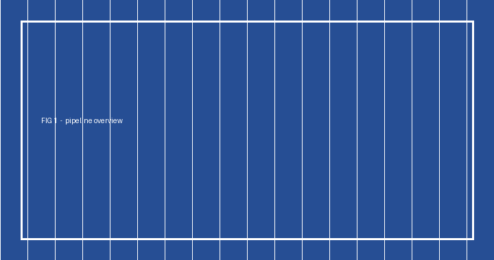
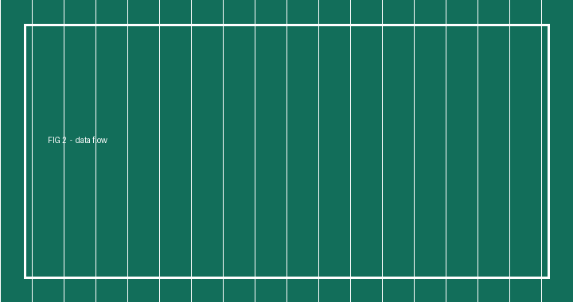

# 读书笔记：注意力机制

## 一、核心思想

注意力机制的本质是**加权求和**。给定一组键值对，用查询向量算出每个键的权重，
再对所有值加权平均得到输出。

上图展示了 QKV 三者的关系。

## 二、自注意力

自注意力中，Q、K、V 都来自同一个输入序列，因此能建模序列内部的长距离依赖。

### 2.1 计算复杂度

标准自注意力的复杂度是 O(n²d)，n 是序列长度，d 是维度。
序列很长时开销很大，这也是后续各种稀疏注意力工作的出发点。

## 三、待补充

- 多头注意力为什么有效，还没想清楚
- 位置编码的几种方案需要对比一下
